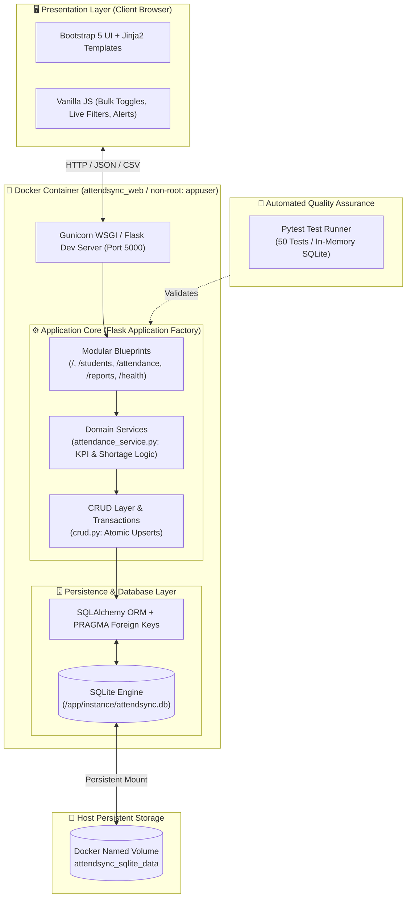

# AttendSync: Modern Attendance Management & Environment Reproducibility System

> **A production-ready, Dockerized web application for academic attendance tracking, analytics, and seamless cross-platform evaluation.**

[](https://www.python.org/)
[](https://flask.palletsprojects.com/)
[](https://www.docker.com/)
[](https://www.sqlite.org/)
[](https://getbootstrap.com/)
[](https://docs.pytest.org/)

---

## 📋 Problem Statement & Core Objectives

### The Problem
Traditional academic attendance tracking is plagued by manual roll calls, fragmented spreadsheets, and error-prone duplicate records. Instructors struggle with real-time tracking of minimum attendance mandates (e.g., 75% attendance threshold), while students lack clear visibility into shortage warnings. Furthermore, in collaborative academic and evaluation environments, differences in operating systems, library versions, and database engines create the classic **"it works on my machine"** dilemma.

### Core Objectives
1. **Automated & Safe Attendance Tracking**:
   - Provide atomic, transaction-safe daily attendance marking with composite unique constraints `(student_id, date)` preventing duplicate entries.
   - Automate real-time KPI metrics, attendance percentages, shortage detection ($<75\%$), and one-click CSV report exports.
2. **Strict Environment Reproducibility**:
   - Deliver a containerized environment using **Docker** and **Docker Compose** ensuring zero configuration drift across Windows, macOS, and Linux.
   - Enforce multi-layer image caching, non-root user execution (`appuser:1000`), healthcheck probes, and persistent volume management.
3. **High Code Quality & Automated Testing**:
   - Guarantee reliability with a comprehensive 50-test Pytest suite covering database schema, atomic upserts, REST routes, and UI components.
4. **Disciplined Team Collaboration**:
   - Implement industry-standard Git Feature-Branch workflows and Conventional Commits for concurrent engineering across 4 team members.

---

## 👥 Team Members & Contribution Matrix

| Member | Name | USN | Project Role | Core Engineering Contributions |
| :---: | :--- | :--- | :--- | :--- |
| **1** | **Nihal Arvind** | `4NI21CS001` *(or edit)* | **Database & Models** | SQLAlchemy ORM models (`Student`, `AttendanceRecord`), schema constraints, SQLite PRAGMA listeners, and CLI initialization commands (`flask init-db`, `seed-db`). |
| **2** | **Niranjan B** | `4NI21CS002` *(or edit)* | **Backend Routes & Logic** | Flask Blueprints (`/students`, `/attendance`, `/reports`), atomic transaction upserts, attendance analytics service, and CSV streaming exports. |
| **3** | **Naresh NP** | `4NI21CS003` *(or edit)* | **Frontend UI & Templates** | Responsive Bootstrap 5 interface, Jinja2 templates (`base.html`, `mark.html`, `reports/index.html`), client-side instant search, and dashboard KPI cards. |
| **4** | **Nahush H M** | `4NI21CS004` *(or edit)* | **Dockerization & Testing** | Multi-layer cached `Dockerfile`, `docker-compose.yml` orchestration, non-root security policy, SQLite volume persistence, and full 50-test Pytest test suite. |

---

## 🏗️ System Architecture & Tech Stack

### High-Level Architecture Diagram



### Tech Stack Overview

| Layer | Technology | Version | Purpose |
| :--- | :--- | :--- | :--- |
| **Backend Framework** | Python / Flask | 3.11 / 3.0.x | Lightweight, modular WSGI application with Application Factory pattern |
| **Database & ORM** | SQLite / SQLAlchemy | 3.x / 2.0.x | Relational storage with declarative models and foreign key cascades |
| **WSGI Server** | Gunicorn | 21.2.x | Production-grade HTTP server with pre-fork worker model |
| **Frontend Styling** | Bootstrap & Icons | 5.3.x | Fully responsive, mobile-first design with accessible UI components |
| **Containerization** | Docker & Compose | v2 / Compose v2 | Environment reproducibility, non-root security, persistent volumes |
| **Automated Testing** | Pytest | 8.x | 50 unit and integration tests executed against isolated test databases |

---

## 🚀 Quickstart Guide (Run with Docker)

### Prerequisites
- [Docker Engine & Docker Compose](https://docs.docker.com/get-docker/) installed and running.
- [Git](https://git-scm.com/) installed.

### 1. Clone the Repository
```bash
git clone https://github.com/2025csprathikgke-crypto/CDD-project.git
cd CDD-project
```

### 2. Launch the Application with Docker Compose
Run the single command below to build the cached container image and start the web server in detached mode:
```bash
docker compose up -d --build
```

### 3. Initialize & Seed Database
Populate the SQLite database with 8 engineering students and realistic historical attendance records:
```bash
docker compose exec web flask seed-db
```

### 4. Access the Live Application
Open your browser and navigate to:
👉 **`http://localhost:5000`**

---

## 🌐 Application URL Reference

| Feature | URL | Description |
| :--- | :--- | :--- |
| **Dashboard** | [http://localhost:5000/](http://localhost:5000/) | Live attendance KPI cards, quick actions, and class metrics |
| **Student Directory** | [http://localhost:5000/students](http://localhost:5000/students) | Student roster, instant search, and registration modal |
| **Mark Attendance** | [http://localhost:5000/attendance/mark](http://localhost:5000/attendance/mark) | Date-picker sheet with "Mark All Present/Absent" toggles |
| **Analytics Reports** | [http://localhost:5000/reports](http://localhost:5000/reports) | Sortable reports with color-coded $<75\%$ shortage badges |
| **CSV Export** | [http://localhost:5000/reports/export](http://localhost:5000/reports/export) | Downloadable attendance summary CSV stream |
| **System Health** | [http://localhost:5000/health](http://localhost:5000/health) | Zero-dependency JSON health probe for container monitoring |

---

## 🧪 Automated Testing & Verification

AttendSync includes a comprehensive test suite of **50 automated Pytest tests** verifying data integrity, uniqueness constraints, atomic upserts, CSV exports, and UI components against an isolated in-memory SQLite database (`sqlite:///:memory:`).

### Run Tests Inside Docker (Recommended)
```bash
# Execute the full 50-test suite inside the container
docker compose run --rm web pytest -v

# Run the attendance & CSV export test suite specifically
docker compose run --rm web pytest tests/test_attendance.py -v
```

### Run Tests Locally (Without Docker)
```bash
# Ensure virtualenv is active and dependencies are installed
pytest -v
```

### Test Coverage Breakdown
- **`tests/test_attendance.py`**: Duplicate marking prevention, composite unique constraints, percentage edge-cases, zero-class division guards, and streamed CSV exports.
- **`tests/test_database.py`**: Model constraints, unique USN/email validation, cascade deletions, and database CLI commands.
- **`tests/test_phase3_endpoints.py`**: REST API routes, atomic bulk transactions, transaction rollbacks, and report sorting.
- **`tests/test_phase4_ui.py`**: Bootstrap 5 rendering, navigation bar, modal dialogs, and shortage indicator badges.
- **`tests/test_health.py`**: Container health probe verification and custom 404/500 error pages.

---

## 🛠️ Docker Management & Teardown

```bash
# View live container logs
docker compose logs -f web

# Stop containers (preserves SQLite database in named volume)
docker compose down

# Stop containers AND delete persistent database volume (clean reset)
docker compose down -v
```

---

## 📁 Repository Structure

```text
CDD-project/
├── app/
│   ├── __init__.py               # Application Factory & Blueprint registration
│   ├── extensions.py             # SQLAlchemy instance & PRAGMA listeners
│   ├── models/                   # SQLAlchemy models (Student, AttendanceRecord)
│   ├── crud.py                   # High-performance CRUD query helpers & transactions
│   ├── commands.py               # Custom Flask CLI commands (flask init-db, flask seed-db)
│   ├── services/                 # Business logic & domain calculations
│   │   └── attendance_service.py # Attendance percentage & shortage analytics
│   ├── routes/                   # Modular Blueprints (MVC Controllers)
│   │   ├── main.py               # Dashboard ('/') & Health ('/health')
│   │   ├── students.py           # Student management (/students, /students/add)
│   │   └── attendance.py         # Marking & reporting (/attendance/mark, /reports)
│   ├── static/                   # Static CSS & JavaScript assets
│   └── templates/                # Jinja2 presentation templates
├── scripts/                      # Automated deployment scripts (deploy.sh, deploy.ps1)
├── tests/                        # 50 Automated Pytest tests
├── docker-compose.yml            # Container orchestration with named volume
├── Dockerfile                    # Multi-layer cached, non-root Debian containerfile
├── requirements.txt              # Pinned Python package dependencies
├── wsgi.py                       # WSGI entrypoint for Gunicorn
└── README.md                     # Project documentation & team submission guide
```

---

## 📜 Academic Submission & License
- **Course**: Software Engineering / Containerized Development
- **Phase**: Phase 7 — Team Collaboration & Submission Documentation
- **License**: MIT Open Source License
